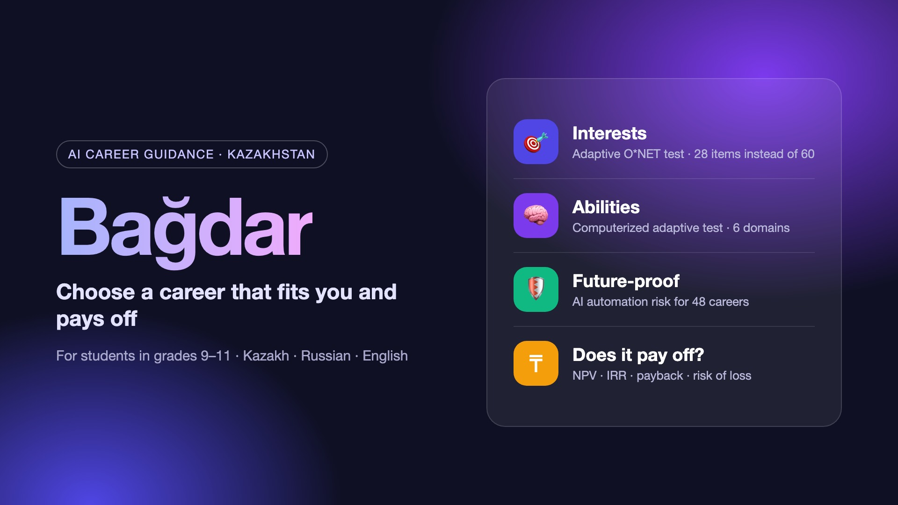

# Bagdar — AI career guidance for Kazakhstan school students



Bagdar helps students in grades 9–11 choose a career based on three things: **interests, abilities and future-proofness**, and shows whether the education investment pays off on Kazakhstan's labour market (NPV, IRR, payback, risk of loss).

Interface: Kazakh, Russian (English in progress).

## How it works

1. **Interests (adaptive).** Items from the O*NET Interest Profiler Short Form (CC BY 4.0, Rounds et al., 2010). The test stops once the top RIASEC types are clearly separated: 24–48 items instead of 60. Attention checks and response-quality flags (Meade & Craig, 2012).
2. **Abilities (computerized adaptive test).** Six domains (logic, numeric, verbal, spatial, mechanical, clerical speed), 3PL IRT model, EAP ability estimate. Items are generated, so every student gets a different set at their level.
3. **Dealbreakers.** The student excludes working conditions they cannot accept (elimination by aspects, Tversky 1972; Gati's PIC model).
4. **AI interview.** A short conversation (Anthropic Claude) about hobbies, favourite subjects and plans. Its effect on the result is bounded, and every quote it uses is checked on the server against the student's own words.
5. **Top 3 and realistic job preview.** Workplaces and a typical day first, then the student's reaction (Wanous, 1973).
6. **Result.** 48 careers from O*NET 30.0, ranked by a weighted geometric mean `I^0.55 · A^0.30 · F^0.15`, so a weak pillar cannot be hidden by a strong one. Future risk = 0.5 · Frey & Osborne (2013) + 0.5 · Eloundou et al. (2023).
7. **Economics.** For each career with Kazakhstan salary data: NPV, IRR, discounted payback and Monte Carlo risk of loss for grant / paid / private study.
8. **Sharing.** A story card, a separate parent link to compare views, and reviews.

## Validation so far (simulation, not real students yet)

| | Top-1 type correct | Items |
|---|---|---|
| Adaptive interest test | 91.5% | 28 |
| Full 60 items | 92.7% | 60 |
| Random 32 items | 85.3% | 32 |

259 virtual students with clear interest profiles. Ability CAT: correlation of estimated with true ability r = .66 at 6 items, with no ceiling effect. A real pilot (300+ students) is next and is needed to calibrate item difficulty.

## Run locally

```bash
python3 -m pip install -r requirements.txt
cp .env.example .env    # set ADMIN_TOKEN, optionally ANTHROPIC_API_KEY
./run.sh                # http://127.0.0.1:8000
```

Without an API key everything works except the AI interview, which the student can skip.

## Structure

```
web/        frontend (vanilla JS ES modules, no build step)
  js/engine.js   scoring, adaptive interest logic
  js/cat.js      IRT computerized adaptive test
  js/econ.js     NPV / IRR / DPP / Monte Carlo
  js/data/       careers (generated), items, filters
server/app.py    FastAPI + SQLite: sessions, AI interview, parent view, admin
research/        build_professions.py builds web/js/data/careers.js from raw datasets
```

To rebuild the career database, put the O*NET 30.0 text files (Interests, Abilities, Knowledge, WorkContext, WorkActivities, JobZones, Occupation_Data), Frey & Osborne (2013) and Eloundou et al. (2023) data into `research/raw/` and run `python3 research/build_professions.py`.

## Privacy

Users are minors: minimal data, parent consent, no names required. Production hosting is planned in Kazakhstan in line with the Law on Personal Data. The API key is only used on the server.

## Data sources and licences

- O*NET 30.0 Database, U.S. Department of Labor — CC BY 4.0
- O*NET Interest Profiler Short Form — CC BY 4.0
- Frey, C. B., & Osborne, M. A. (2013). The Future of Employment
- Eloundou, T. et al. (2023). GPTs are GPTs
- hh.kz salary data (collected 2026)

## Team

Serikkali Omar, Egibay Nurali.
